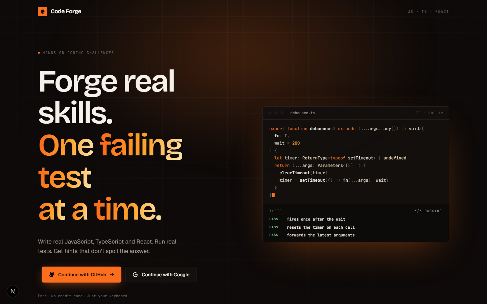
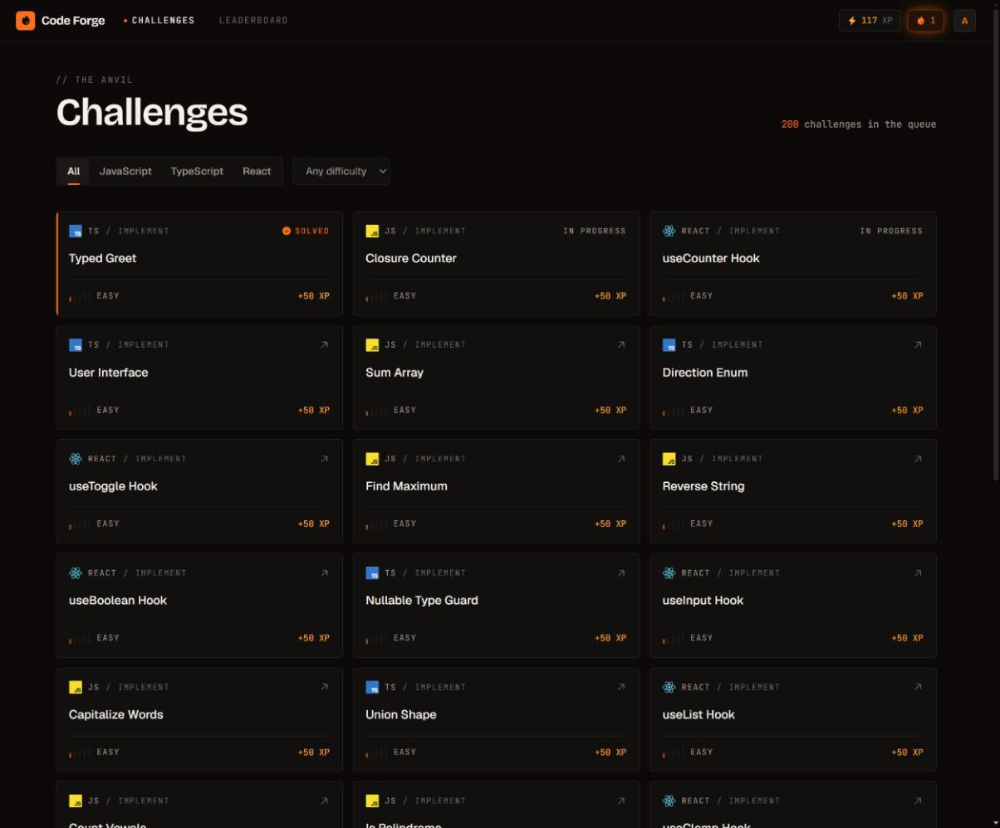
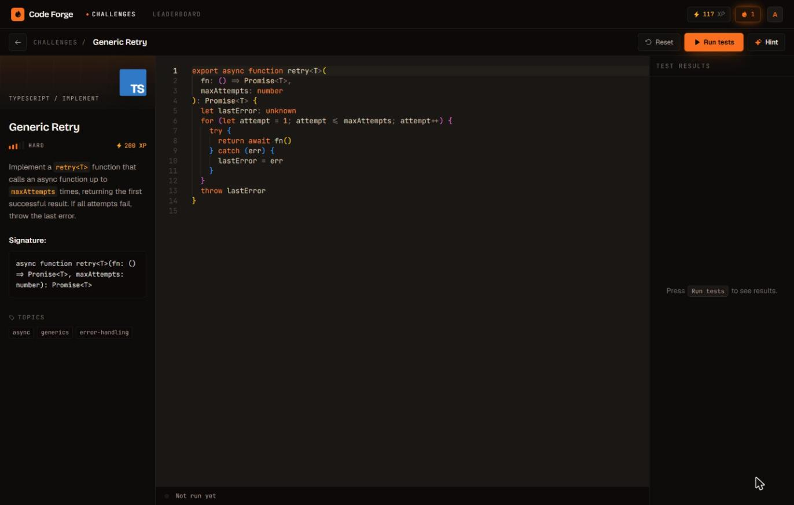
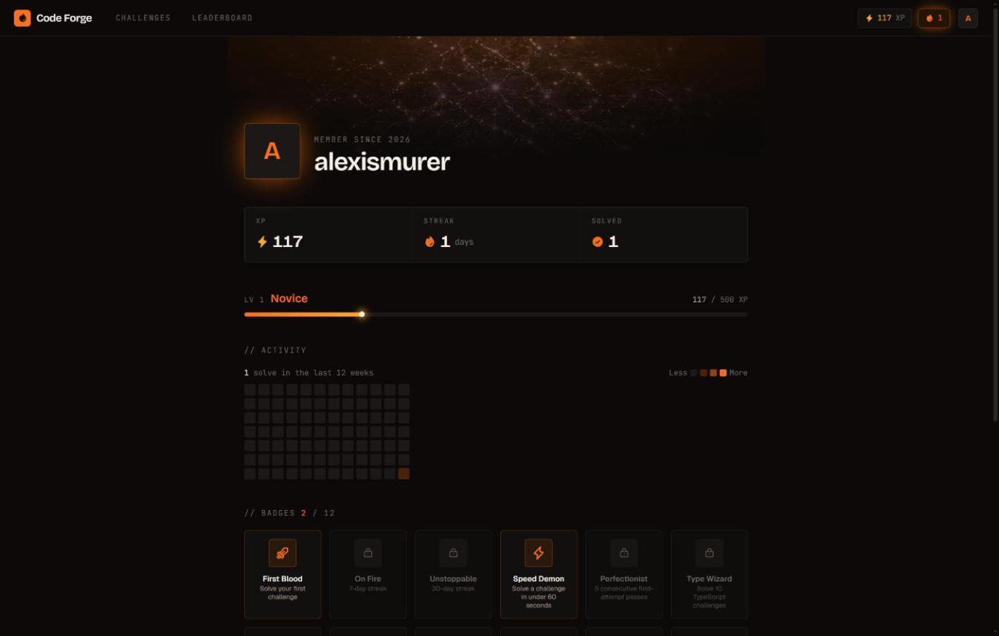

# Code Forge

**Forge real skills. One failing test at a time.**

Code Forge is a hands-on coding challenge platform for JavaScript, TypeScript and React. Write real code in a real editor, run it against a real test suite, and get AI hints that nudge without spoiling the answer. Every solve earns XP, feeds your streak and climbs a live leaderboard.



## Features

- **200 challenges** across JS, TS and React: implement, fix the bug, refactor, or quiz, rated 1–5 in difficulty
- **In-browser editor** powered by Monaco, with code executed in a sandboxed iframe — no server round-trips
- **Instant test feedback** with pass/fail per case
- **AI hints** streamed from Llama 3.3 70B (via Groq) that point you in the right direction without handing over the solution
- **Progression**: XP, levels, daily streaks, badges and an activity heatmap
- **Live leaderboard** with real-time updates

| Challenges | Editor |
| --- | --- |
|  |  |



## Tech stack

Next.js 16 (App Router) · React 19 · TypeScript · Tailwind CSS v4 · shadcn/ui · GSAP · Clerk · Supabase · Groq · Vitest

## Getting started

```bash
npm install
# create .env.local with the keys below
npm run seed                 # load challenges into Supabase
npm run dev
```

Open [http://localhost:3000](http://localhost:3000).

### Environment variables

| Variable | Purpose |
| --- | --- |
| `NEXT_PUBLIC_SUPABASE_URL` | Supabase project URL |
| `NEXT_PUBLIC_SUPABASE_ANON_KEY` | Anon key (real-time leaderboard only) |
| `SUPABASE_SERVICE_ROLE_KEY` | Service role key (all server-side DB access) |
| `NEXT_PUBLIC_CLERK_PUBLISHABLE_KEY` | Clerk publishable key |
| `CLERK_SECRET_KEY` | Clerk secret key |
| `GROQ_API_KEY` | Groq API key for AI hints |

Apply the SQL files in `supabase/migrations/` to your Supabase project before seeding.

## Scripts

| Command | Description |
| --- | --- |
| `npm run dev` | Start the dev server |
| `npm run build` | Production build |
| `npm test` | Run the test suite |
| `npm run seed` | Seed challenges from `content/challenges/` |
